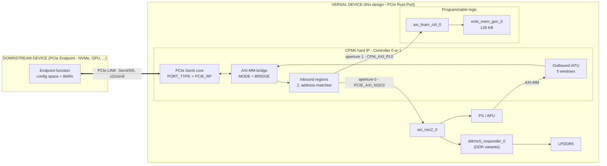
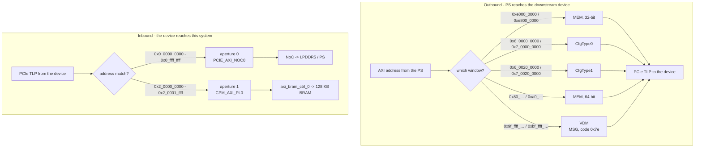
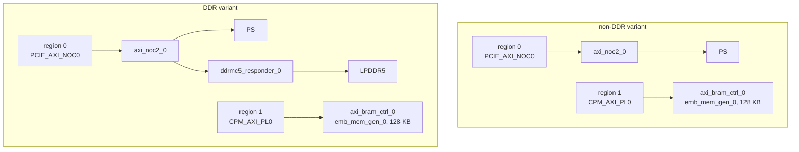
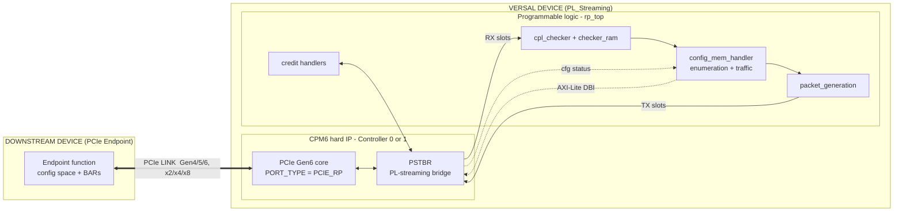
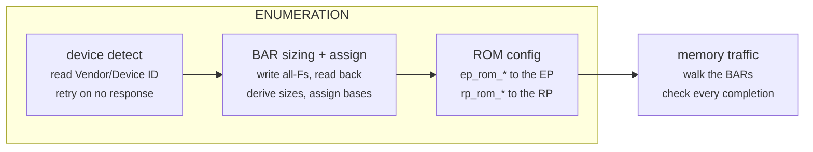
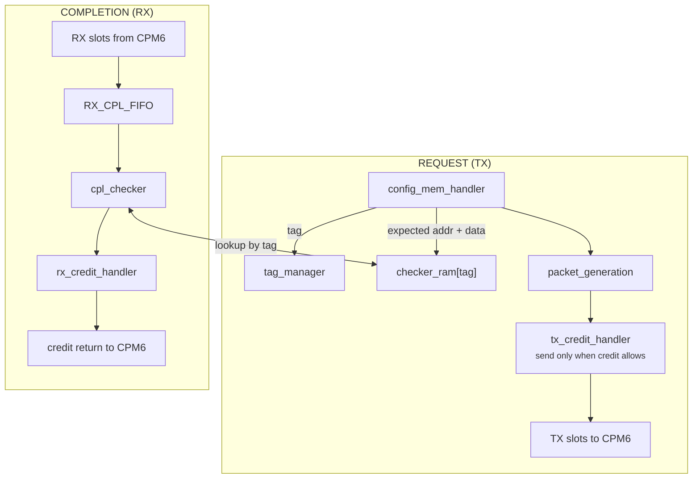

# Versal CPM6 PCIe Root Port Design

| Item | Summary |
|---|---|
| **Primary Purpose** | Versal CPM6 hard IP as a PCIe Gen6 **Root Port**, in AXI-MM bridge or PL-streaming mode |
| **Configurations** | `AXI_Bridge` × {Controller_0, Controller_1} × {DDR, non-DDR}, plus `PL_Streaming` × {Controller_0, Controller_1} |
| **Example Type** | IP Example Design (CED) |
| **Target Audience** | Verification/FPGA engineers bringing up a CPM6 Root Port |
| **Devices Supported** | `xc2vp3602-vsvc3340-3HP-e-S`, `xc2vp3602-vsvc3340-2LHP-e-S` |
| **Tools Required** | Vivado 2026.2, VCS/Verdi Y-2026.03 with UVM 1.1, Avery PLI and apci-xactor 2025.3_1, CPM6 Secure IP package |
| **Simulators Validated** | VCS (waveforms via Verdi or DVE) |
| **Boards Validated** | VPK360 — `AXI_Bridge` variants link and pass traffic on hardware |
| **Pre-Built Images** | Not available |
| **Key Features Shown** | Root Port enumeration, outbound CfgType0/1 + MEM + VDM windows, address-matched inbound regions into LPDDR5 and PL block RAM, PL-streaming datapath with credit handling and per-completion checking, selectable link width (X2/X4/X8) and lane rate (16.0/32.0/64.0 GT/s) |
| **Not Intended For** | Production deployment, performance benchmarking |
| **Time to First Success** | ~20–25 minutes (generate + compile + optimize + simulate) — order of magnitude, not independently benchmarked |

VLNV `xilinx.com:design:cpm6_pcie_rp:1.0`.

---

## Design architecture

The design provides a single PCIe Gen6 Root Port on CPM6 Controller 0 or
Controller 1. Two modes decide **who owns the datapath above the link**:

In `AXI_Bridge` the CPM6 AXI-MM bridge owns the datapath and performs the
address translation. In `PL_Streaming` the programmable logic owns it, and
there is no translation. Only `AXI_Bridge` offers LPDDR5 over the NoC.

Everything from here to *Bringing up the link* applies to both. The two modes
are then described in their own sections.

---

## Choosing a configuration

- `DESIGN_MODE` — `AXI_Bridge` (default) or `PL_Streaming`
- `CTRL_CONFIG` — `Controller_0` or `Controller_1` (default)
- `IDE` — boolean, default `false`. Adds PCIe Integrity and Data Encryption
  (see [IDE](#ide-integrity-and-data-encryption)). VPK360 (`vsvc3340`) only.
  Selecting it forces `DDR_EN` on and greys it out.
- `DDR_EN` — boolean, default `false`. Not available with `PL_Streaming`, which
  has no NoC or DDR path of its own; `PL_Streaming` gets one only with `IDE`.
- `CTRL_LANE_RATE` — `16.0_GT/s`, `32.0_GT/s` or `64.0_GT/s` (default)
- `CTRL_LINK_WIDTH` — `X2`, `X4` or `X8` (default)

### What you get

| `DESIGN_MODE` | `CTRL_CONFIG` | `DDR_EN` | Sub-design | Top module |
|---|---|---|---|---|
| `AXI_Bridge` | `Controller_0` | `false` | `brdg_ctrl0/` | `rp_axi_mmbr_top_wrapper_ctrl0` |
| `AXI_Bridge` | `Controller_0` | `true` | `brdg_ddr_ctrl0/` | `rp_axi_mmbr_ddr_top_wrapper_ctrl0` |
| `AXI_Bridge` | `Controller_1` | `false` | `brdg_ctrl1/` | `rp_axi_mmbr_top_wrapper_ctrl1` |
| `AXI_Bridge` | `Controller_1` | `true` | `brdg_ddr_ctrl1/` | `rp_axi_mmbr_ddr_top_wrapper_ctrl1` |
| `PL_Streaming` | `Controller_0` | n/a | `plstr_ctrl0/` | `rp_plstr_top_wrapper_ctrl0` |
| `PL_Streaming` | `Controller_1` | n/a | `plstr_ctrl1/` | `rp_plstr_top_wrapper_ctrl1` |

With `IDE` on, `AXI_Bridge` uses the `brdg_ddr_*` sub-design (`DDR_EN` is implied)
and `PL_Streaming` keeps its `plstr_*` sub-design, to which the SoC platform adds
the NoC and LPDDR5.

Width and rate are applied when the block design is built, so the generated
design and the generated `defines.sv` always agree.

Whichever controller you select is the active one. The other is left entirely
unconfigured and its pins are unused. There is no dual-controller
configuration — the two cannot be brought up together in one design.

---

## Getting started

### Before you begin

1. Download and unzip the CPM6 Secure IP package (provided separately) from
   https://account.amd.com/en/member/cpm6-simulation.html
2. Set the following environment variables (tcsh or bash shell):
   - `VCS_HOME` -- VCS install
     ```
     tcsh: setenv VCS_HOME <path to vcs install>
     bash: export VCS_HOME=<path to vcs install>
     ```
   - `AVERY_PLI` -- Avery PLI binary location
     ```
     tcsh: setenv AVERY_PLI <path to avery pli install>
     bash: export AVERY_PLI=<path to avery pli install>
     ```
   - `AVERY_PCIE` -- Avery PCIe source libraries
     ```
     tcsh: setenv AVERY_PCIE <path to avery apci xactor install>
     bash: export AVERY_PCIE=<path to avery apci xactor install>
     ```
   - `AVERY_SIM` -- Avery simulation libraries
     ```
     tcsh: setenv AVERY_SIM <path to avery sim install>
     bash: export AVERY_SIM=<path to avery sim install>
     ```
   - `CPM6_SECUREIP` -- directory where the CPM6 Secure IP package was extracted
     ```
     tcsh: setenv CPM6_SECUREIP <path to extracted cpm6 secureip>
     bash: export CPM6_SECUREIP=<path to extracted cpm6 secureip>
     ```
   - `VIVADO_CLIBS` -- directory containing your precompiled VCS simulation libraries for the selected Vivado/VCS version
     ```
     tcsh: setenv VIVADO_CLIBS <path to compiled simlibs>
     bash: export VIVADO_CLIBS=<path to compiled simlibs>
     ```
   Verify:
   ```
   echo $VCS_HOME       # should show Y-2026.03 path
   echo $AVERY_PLI      # should show avery_pli-2025.3_1 path
   echo $AVERY_PCIE     # should show apcievip-2025.3_1 path
   echo $AVERY_SIM      # should show avery_sim-2025.3_1 path
   echo $CPM6_SECUREIP  # should show your extracted path
   echo $VIVADO_CLIBS   # should show your compiled simlib path
   ```

Qualified versions: Vivado 2026.2, VCS/Verdi Y-2026.03 with UVM 1.1, Avery PLI
and apci-xactor 2025.3_1. Verdi is optional and only needed for waveforms.

### Generating the design

```tcl
create_project p ./p -part xc2vp3602-vsvc3340-3HP-e-S
create_bd_design cpm6_pcie_rp
source <this dir>/init.tcl
createDesign cpm6_pcie_rp [dict create DESIGN_MODE AXI_Bridge CTRL_CONFIG Controller_1 DDR_EN false]
```

This one step builds the block design, regenerates `defines.sv` to match the
chosen width and rate, adds the constraints the variant needs, generates the VCS
simulation scripts, and copies the `sim/` directory alongside the project. There
is no separate `launch_simulation` step.

You should end up with:

```
<project>/sim/              Makefile, tb/, test/, verif/  - ready to build
<project>/p.sim/.../vcs/    compile.sh, elaborate.sh, simulate.sh
```

### Running the simulation

From `<project>/sim`:

| Command | Effect |
|---|---|
| `make cos` | compile, optimize and simulate |
| `make cos DUMP=1` | the same, with a waveform dump |
| `make s TEST=<name>` | re-simulate only |
| `make distclean` | wipe the compiled libraries and start fresh |
| `make h` | show all options |

**Expected outcome:**
Simulation completes with `UVM_ERROR : 0` and `UVM_FATAL : 0` in the report
summary at the end of `vcs.sim.log`.

`PL_Streaming` also writes additional per-transaction logs into the run
directory alongside `vcs.sim.log`.

#### Available tests

One test per mode, plus an IDE variant. Each is selected automatically by the
design you generated; pass `TEST=` only to override.

| Mode | Test | What it does |
|---|---|---|
| `AXI_Bridge` | `test_ps_transactions` | Enumerates the downstream device, then exercises outbound and inbound memory traffic. |
| `PL_Streaming` | `test_rp_traffic` | Brings the link to L0, enumerates from the ROM vectors, then runs `TRAFFIC_COUNT` memory read/write pairs. |

With `IDE` on, the default test is the mode's IDE test:

| Mode | IDE test | What it adds |
|---|---|---|
| `AXI_Bridge` | `test_brdg_ide_basic` | `test_ps_transactions` with IDE brought up before the inbound traffic, which then runs over the secured link. |
| `PL_Streaming` | `test_rp_ide_basic` | `test_rp_traffic` with IDE brought up while the RTL holds its traffic until the RP's IDE stream is Secure. |

The IDE keys are programmed directly on both sides (no SPDM), with the VIP as the
Endpoint. The test fails unless protected TLPs were seen in both directions.
Link IDE is on by default; `+IDE_SEL=1` adds a Selective IDE stream and
`+IDE_LINK=0` turns Link IDE off.

What a passing run looks like differs by mode; see the simulation subsection
inside each mode's section for the criteria it reports.

## Bringing up the link

`hw/` has two scripts for bringing the link up and enumerating the downstream
device over JTAG, once the design is programmed.

```tcl
connect
source hw/bringup.tcl
bringup -controller ctrl1                  ;# AXI_Bridge
bringup -controller ctrl1 -enumerate 0     ;# PL_Streaming
```

`bringup` pulses PERST and confirms the link - both modes. It then enumerates
the device, which is **AXI_Bridge only**: `enumerate_downstream` reaches config
space through the outbound Config window, and PL_Streaming has none. Pass
`-enumerate 0` there; the fabric's `config_mem_handler` enumerates instead.

```
=== CPM6 Root Port bring-up, ctrl1 ===
  PERST        endpoint, then ctrl1
  Link         Gen5 x8  LTSSM 0x11  DLL=1   up 5/5
```

`-controller` must match the variant that was built.

If the link is already up, enumeration can be run on its own (AXI_Bridge only):

```tcl
source hw/enumerate_downstream.tcl
enumerate_downstream -controller ctrl1
```

`enumerate_downstream` programs BAR0 and sets Memory Space and Bus Master
Enable; `-read-only` skips those writes. Options for both scripts are listed
at the top of each file.

### PERST

**The link will not come up until PERST is toggled.**

PERST is two pulses, one to the endpoint and one to the controller. The pin
numbers are those used on the VPK360; another board may route PERST
differently. The boot image already configures all four pins as outputs —
you only need to toggle them.

| | Controller 0 | Controller 1 |
|---|---|---|
| Endpoint PERST | `PMC_MIO_40` | `PMC_MIO_41` |
| drive low / high | `0xF1020008` ← `0xBFFF0000` / `0xBFFF4000` | `0xF1020008` ← `0x7FFF0000` / `0x7FFF8000` |
| Controller PERST | `PS_MIO_18` | `PS_MIO_19` |
| drive low / high | `0xFF0B0004` ← `0xFFFB0000` / `0xFFFB0004` | `0xFF0B0004` ← `0xFFF70000` / `0xFFF70008` |

### Checking the link

Controller 0 addresses shown, Controller 1 in brackets.

`PCIE_STATUS_REGISTER` — `0xFC84078C` [`0xFC94078C`]

| Bits | Field | Meaning |
|---|---|---|
| `[5:0]` | `ltssm_status` | LTSSM state. **`0x11` = L0**, the link is up |
| `[7:6]` | `link_width` | negotiated width |
| `[10:8]` | `link_speed` | negotiated speed |

`PF0_PCIE_CAP_LINK_CONTROL_LINK_STATUS_REG` — `0xFC000080` [`0xFC400080`]

| Bits | Field | Meaning |
|---|---|---|
| `[29]` | `DLL_ACTIVE` | Data Link Layer active — `1` once the link is usable |
| `[27]` | `LINK_TRAINING` | LTSSM is in Configuration or Recovery |
| `[25:20]` | `NEGO_LINK_WIDTH` | negotiated link width |
| `[19:16]` | `LINK_SPEED` | current link speed |

---

## AXI_Bridge mode

The bridge translates between AXI-MM and PCIe in both directions. Both variants
use the same address map — they differ only in what sits behind the NoC.

### AXI_Bridge architecture



The **PCIe link** is the thick double line. Everything to the left of it is the
other device; everything to the right is this design.

### How an address becomes a transaction



### Outbound windows

| Window | Purpose | Controller 0 | Controller 1 |
|---|---|---|---|
| 0 | Memory, 32-bit | `0xe000_0000` – `0xe7ff_ffff` | `0xe800_0000` – `0xefff_ffff` |
| 1 | Config, Type 0 | `0x6_0000_0000` – `0x6_001f_ffff` | `0x7_0000_0000` – `0x7_001f_ffff` |
| 2 | Config, Type 1 | `0x6_0020_0000` – `0x6_ffff_ffff` | `0x7_0020_0000` – `0x7_ffff_ffff` |
| 3 | Memory, 64-bit | `0x80_0000_0000` – `0x9f_fffe_ffff` | `0xa0_0000_0000` – `0xbf_fffe_ffff` |
| 4 | Vendor Defined Messages (VDM), `MSG_CODE 0x7e` | `0x9f_ffff_0000` – `0x9f_ffff_ffff` | `0xbf_ffff_0000` – `0xbf_ffff_ffff` |

Windows 1 and 2 are the ECAM windows. The remaining windows carry memory
traffic and are what the downstream device's BARs are assigned into during
enumeration.

BAR addresses and the Type 1 bridge windows are **not** fixed by this design.
Enumeration assigns them at run time, so read them back from the device rather
than assuming a layout.

### Inbound regions and apertures

Same for both controllers and both variants.

| Region | Address range | Aperture | `DEST` | Lands in |
|---|---|---|---|---|
| 0 | `0x0_0000_0000` – `0x0_ffff_ffff` | 0 | `PCIE_AXI_NOC0` | LPDDR5 and the PS, via the NoC |
| 1 | `0x2_0000_0000` – `0x2_0001_ffff` | 1 | `CPM_AXI_PL0` | PL block RAM, 128 KB |

### Memory behind the apertures



### LPDDR5 (DDR variants only)

| Property | Value |
|---|---|
| Controller type | `LPDDR5_SDRAM` |
| Channels / controllers / ranks | 1 / 1 / 1 |
| Speed grade | `LPDDR5X-7500` (VPK360 board preset, tCK 1087 ps) |
| DRAM size | 16 Gb |
| MC data width | 32 |
| Frequency switching | disabled |

Pin placement and electrical constraints for the LPDDR5 PHY are in
`constrs/ddr_vpk360.xdc`, added by `run.tcl` when `DDR_EN` is true.

---

### AXI_Bridge simulation

The bridge variants run `test_ps_transactions`, which enumerates the downstream
device and then exercises both directions.

| Check | non-DDR | DDR |
|---|---|---|
| Configuration read/write to the device | ✅ | ✅ |
| BAR readback over the outbound windows | 2 | 2 |
| Inbound write/read to PL block RAM | 2 | 2 |
| Inbound write/read to LPDDR5 | ✗ | 2 |
| Independent readback of LPDDR5 from the R5 | ✗ | 2 |
| **Total matches expected** | **4** | **8** |

A passing run ends with `UVM_ERROR : 0` and `UVM_FATAL : 0` in `vcs.sim.log`,
and in `rp_bridge_log.txt` a line reading
`SUMMARY: 4 match, 0 mismatch, 0 UR` (non-DDR) or `8 match` (DDR).
`rp_bridge_log.txt` also carries a per-transaction table, which is the first
place to look if a run does not pass.

---

## PL_Streaming mode

In PL streaming mode the **programmable logic owns the datapath**. The CPM6 hard
IP terminates the link and presents a credit-based streaming interface; request
generation, enumeration and completion checking are all RTL in the fabric. The
design therefore contains no address translation at all — no outbound windows,
no inbound regions, no MMIO apertures.

### Architecture



### What the PL must provide

The block design exposes these to the fabric; `rp_top` drives them:

| Port | Direction | Purpose |
|---|---|---|
| `pcie<n>_strm` | Slave | PL-streaming TLP interface — TX and RX slots, credits |
| `pl_axil_dbi<n>` | Slave | AXI-Lite DBI, for configuring the Root Port itself |
| `pcie<n>_cfg_status` | Master | Config status from CPM6 (link state, negotiated width and speed) |
| `ctrl<n>_gt_refclk` | Slave | GT reference clock |
| `pl0_ref_clk`, `pl0_resetn` | Output | PL clock and reset from the PS |
| `pcie<n>_rstn`, `dbi<n>_rstn` | Output | Interface resets |

### How the design works

`config_mem_handler` sequences everything. Enumeration comes first, in three
parts, then traffic runs:



BAR bases are packed downward from the top of the address space, largest BAR
first, so every BAR lands naturally aligned.

The RTL that does this sits under `rp_top`:

```
rp_plstr_top_wrapper_ctrl<n>            top wrapper
└── rp_top
    ├── rp_config_handler               configures the RP itself
    │   ├── rp_config_pl_dbi              AXI-Lite DBI transactions
    │   └── rp_config_status              config status from CPM6
    ├── config_mem_handler              central orchestrator
    │   ├── bar_handler                   BAR sizing and base assignment
    │   ├── traffic_valid_generator       slot valid/end, payload size
    │   └── address_gen                   address walk within the BARs
    │       └── address_buffer
    ├── packet_generation               builds posted / non-posted TLPs
    ├── completor_wrapper
    │   ├── cpl_checker                   completion vs. expected
    │   │   └── completor
    │   └── RX_CPL_FIFO                   circular completion FIFO
    ├── checker_ram x2                  expected addr/data, indexed by tag
    ├── tag_manager                     non-posted tag allocation
    ├── tx_credit_handler
    └── rx_credit_handler
```

Every non-posted request records its expected address and data in a checker RAM
at its tag. The completion is looked up by the tag in its header and compared —
that is how a data error is detected.



### PL streaming interface

| | |
|---|---|
| Clock | `pl_strm_clk`, from PL0 — 384 MHz on `-3HP`, 300 MHz on `-2LHP` |
| Slot width | 512 b = 64 B = 16 DW |
| TLP types | Posted, Non-posted, Completion |

### Bring-up

PERST is on `PS_MIO_18` for Controller 0 and `PS_MIO_19` for Controller 1. The
PERST pulses and link check in [Bringing up the link](#bringing-up-the-link)
apply; enumeration does not - use `bringup -controller ctrl1 -enumerate 0`.

### Simulation

The PL streaming variants run `test_rp_traffic` by default:

| Test | What it does |
|---|---|
| `test_rp_traffic` | **default.** Full enumeration from the ROM vectors, then `TRAFFIC_COUNT` memory read/write pairs. DUT error counters are cross-checked against the scoreboards. |

It is controller-agnostic; plusargs derived from the generated design select the
active controller, so the same test file serves both.

A passing run ends with `UVM_ERROR : 0`, `UVM_FATAL : 0` and a summary in
`rp_flow_log.txt` naming each criterion. For example, from a Controller 1
Gen6 x4 run:

```
==================== RESULT ====================
  Link          : PASS  negotiated Gen6 x4, configured Gen6
  Device detect : PASS  EP 0x1234abcd at BDF 0x0100
  Enumeration   : PASS  ROM 15/15 entries exercised, 6/6 BAR bases verified
  Memory flow   : PASS  200 reads / 200 writes / 200 completions, 0 data errors
  Credits       : PASS  TX 64/64 and RX 48/48 returned (no leak)
  Consistency   : PASS  scoreboard and RTL error counters agree
================================================
```

The `Link` line reports what the design was configured for. The remaining
counts depend on the stimulus rather than being fixed: the ROM totals follow the
vectors in `plstr_src/mem/`, and the memory counts follow `TRAFFIC_COUNT`. A run
with different ROM contents or a different traffic count reports different
numbers and still passes.

`rp_flow_log.txt` also carries a readable per-transaction narrative.

Verbosity: `make s VERBOSITY=LOW` (default, flow only), `MEDIUM` (per-check
detail and credit movement), `HIGH` (full TLP object dumps).

### Exploring or extending

* **Traffic volume** — `TRAFFIC_COUNT` sets how many memory read/write pairs run
  after enumeration.
* **Link speed or width** — regenerate with a different `CTRL_LANE_RATE` /
  `CTRL_LINK_WIDTH`; the link package, slot count and simulation plusargs all
  follow automatically.
* **What gets configured** — the ROM vectors in `plstr_src/mem/` drive both the
  EP and RP configuration walks. Adding an entry adds a config transaction.

Modifying the scoreboards or checker RAMs will silently weaken the pass
criteria; prefer changing the stimulus.

---

## IDE (Integrity and Data Encryption)

For the selected controller (`CTRLx`), `IDE`:

- sets `CPM6_CTRLx_IDE_CAP_EN`, `CPM6_CTRLx_LINK_IDE_STREAM_EN` and
  `CPM6_CTRLx_SELECTIVE_IDE_STREAM_EN` (0 when `IDE` is off).
- adds DDR, which the SEC firmware needs. `AXI_Bridge` switches to the
  `brdg_ddr_*` sub-design (as with `DDR_EN`). `PL_Streaming` has no NoC of its
  own, so the SoC platform (`platform/`) adds the NoC, the LPDDR5 controller and
  ports, and their pin constraints. In both modes `R5_0` sees DDR at 0x0, 2 GB.
- PS settings for the SEC firmware: UART0 and UART1 (115200 baud), TTC0, TTC1,
  and IPI1 with `R5_0` as master. With the platform these come from it.
- `AXI_Bridge` only: the R5 reaches PCIe config space through a 256 MB window at
  0xE000_0000 (256 buses of ECAM), which the NoC remaps onto the CPM's ECAM.
- `PL_Streaming` only: the R5 reaches PCIe config space through the same 256 MB
  window at 0xE000_0000, which the NoC routes to a new PL port, `M00_AXI_0`
  (AXI4-Lite). There `axil_cfg_bridge` turns the ECAM-style accesses into
  configuration TLPs. `rp_top` holds its memory traffic until a Link or Selective
  IDE stream of the root port reports Secure; it finds the RP IDE capability at
  config offset 0xCB0.

### Firmware

The SEC firmware runs on `R5_0`. `fw/` is a placeholder for it; nothing is built
or wired into the PDI yet. See [fw/README.md](fw/README.md).

### Not done yet

- `hw/bringup.tcl` and `hw/enumerate_downstream.tcl` have no IDE steps.

---

## Layout

```
design.xml  init.tcl  run.tcl  xitem.json  cpm6_pcie_rp.PNG
constrs/            ddr_vpk360.xdc               AXI_Bridge DDR variants
platform/                                        SoC platform (all AXI_Bridge designs; PL_Streaming with IDE)
fw/                                              IDE firmware placeholder
src/                defines.sv                   regenerated into the project
                                                 at build time, not edited here
plstr_src/                                       PL streaming RTL and link packages
sim/                                             common simulation layer
hw/                 bringup.tcl                  JTAG bring-up and enumeration
                    enumerate_downstream.tcl
brdg_sim_common/                                 shared across bridge variants
plstr_sim_common/                                shared across PL streaming variants
brdg_ctrl0/  brdg_ctrl1/  brdg_ddr_ctrl0/  brdg_ddr_ctrl1/
plstr_ctrl0/  plstr_ctrl1/
```

Each variant directory holds its block design script, its RTL wrapper, and the
simulation files specific to it.

The simulation tree is assembled from three layers when the project is
generated: the common `sim/` directory, then the shared layer for the mode, then
the variant's own files, each overriding the last. Because this happens at
generation time, editing a file under a variant's `sim/` directory does not
reach a project you have already generated — regenerate to pick it up.

---

## Reference

- AMD Versal Adaptive SoC CPM6 documentation — the Documentation tab of the
  `ps_wizard` IP customisation GUI in Vivado, or docs.amd.com
